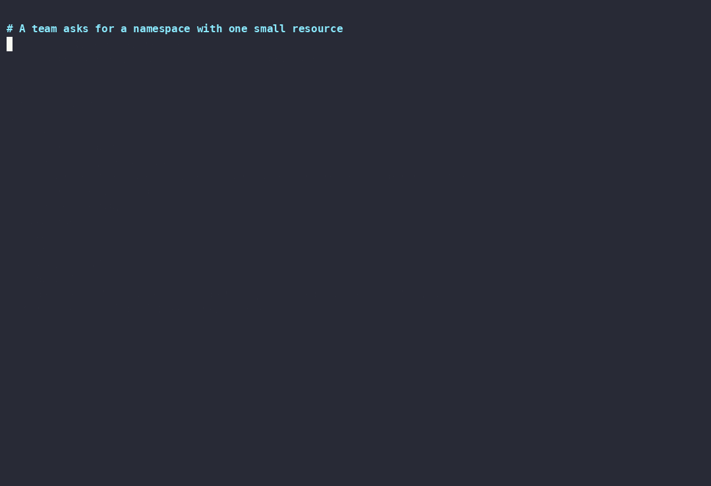

# team-operator

A Kubernetes operator, written in Go with controller-runtime, that turns one
small `Team` resource into a namespace a team can use safely on day one.

[](https://github.com/kmvarma12133/team-operator/actions/workflows/ci.yml)



*Recorded on a kind cluster in GitHub Actions by the
[`demo` workflow](.github/workflows/demo.yml), running [`hack/demo.sh`](hack/demo.sh).*

```yaml
apiVersion: tenancy.kmvarma12133.github.io/v1alpha1
kind: Team
metadata:
  name: payments
spec:
  members:
    - kind: Group
      name: payments-devs
  costCenter: cc-1042
  quota: { cpu: "8", memory: 16Gi, pods: 40 }
```

```console
$ kubectl get teams
NAME       NAMESPACE       READY   REASON              AGE
payments   team-payments   True    Provisioned         12s
legacy                     False   NamespaceConflict   4s
```

## What a Team gets

| Object | Purpose |
| --- | --- |
| Namespace `team-<name>` | `owner` and `cost-center` labels for cost allocation; Pod Security `restricted` enforced |
| ResourceQuota `team-quota` | Caps total CPU and memory requests and the pod count |
| LimitRange `team-defaults` | Gives containers that set no resources sensible requests and limits, so the quota never rejects them |
| NetworkPolicy `default-deny` | Denies all ingress and egress... |
| NetworkPolicy `allow-same-namespace-and-dns` | ...except traffic inside the namespace and DNS to kube-dns |
| RoleBinding `team-members` | Members get the built-in `edit` role here, and nowhere else |

Every object carries the `owner` label the
[cloud-platform-blueprint](https://github.com/kmvarma12133/cloud-platform-blueprint)
Gatekeeper policy requires, so team namespaces pass the platform's admission rules.

## Design decisions

- **Server-side apply for every write.** The operator applies its desired
  state under the field manager `team-operator` with forced ownership. It
  never reads before writing, it never fights other tools over fields it does
  not set, and a hand edit to a field it owns is reverted on the next
  reconcile. Watches on every managed kind trigger that reconcile within
  seconds.
- **A cache that only holds the operator's objects.** Informers for
  namespaces, quotas, limit ranges, network policies and role bindings are
  filtered to objects with the team label, so memory does not grow with the
  size of the cluster.
- **Never adopt someone else's namespace.** If `team-<name>` already exists
  and was not created for this Team, the Team reports `NamespaceConflict` and
  nothing is changed. That check reads straight from the API server, because
  the filtered cache cannot see unlabelled namespaces.
- **Deleting a Team does not delete workloads by default.** With
  `deletionPolicy: Retain` (the default) the namespace has no owner reference
  and outlives its Team; recreating the Team adopts it again. With `Delete`,
  the namespace is owned by the Team and garbage-collected with it. Switching
  the policy adds or removes the owner reference.
- **Least-privilege RBAC.** The ClusterRole is generated from
  `+kubebuilder:rbac` markers and has no `delete` verb at all. Instead of
  holding every permission in `edit` in order to grant it, the operator has
  the `bind` verb on that one ClusterRole only.
- **Validation in the API server.** CEL rules in the CRD reject a Team whose
  name would not make a valid namespace, a request above its limit, an empty
  member list or an unknown deletion policy, before the operator sees it.

## Testing

| Layer | What it proves |
| --- | --- |
| envtest (`make test`) | Against a real kube-apiserver and etcd: provisioning and defaults, drift reverted, spec changes applied, foreign namespaces left alone, owner references follow the deletion policy, retained namespaces re-adopted, CEL validation |
| kind e2e (`make e2e`, in CI) | On a real cluster with the chart installed: Pod Security rejects a privileged pod, LimitRange defaults a pod's resources, members can deploy but cannot grant access, manual edits reverted, Retain keeps the namespace |
| Chart (`make helm-lint`) | `helm lint` and every rendered manifest validated with kubeconform |

## Supply chain

CI builds the image once and passes the same tarball to every later job, so
the bytes that are scanned and tested are the bytes that ship. Trivy blocks
fixable HIGH and CRITICAL CVEs, Syft produces an SPDX SBOM, and on `main` the
image is pushed to GHCR and signed with keyless Cosign plus an SBOM
attestation. Base images are pinned by digest and every action by commit SHA.
The image is distroless, runs as UID 65532 with a read-only root filesystem,
and serves metrics over HTTPS behind token authentication.

## Install

```sh
helm install team-operator charts/team-operator \
  --namespace team-operator-system --create-namespace
kubectl apply -f config/samples/team.yaml
kubectl get team payments
```

Verify the image signature first:

```sh
cosign verify ghcr.io/kmvarma12133/team-operator@<digest> \
  --certificate-identity-regexp '^https://github.com/kmvarma12133/team-operator/' \
  --certificate-oidc-issuer https://token.actions.githubusercontent.com
```

## Development

```sh
make generate      # deepcopy, CRD and RBAC from the Go types and markers
make test          # envtest (Linux/macOS)
make test-docker   # the same on Windows, in a Linux container
make run           # run against your current kubeconfig
make help          # everything else
```

controller-runtime v0.25's envtest does not compile on Windows, so Windows
hosts use `make test-docker`.

## License

Apache 2.0
